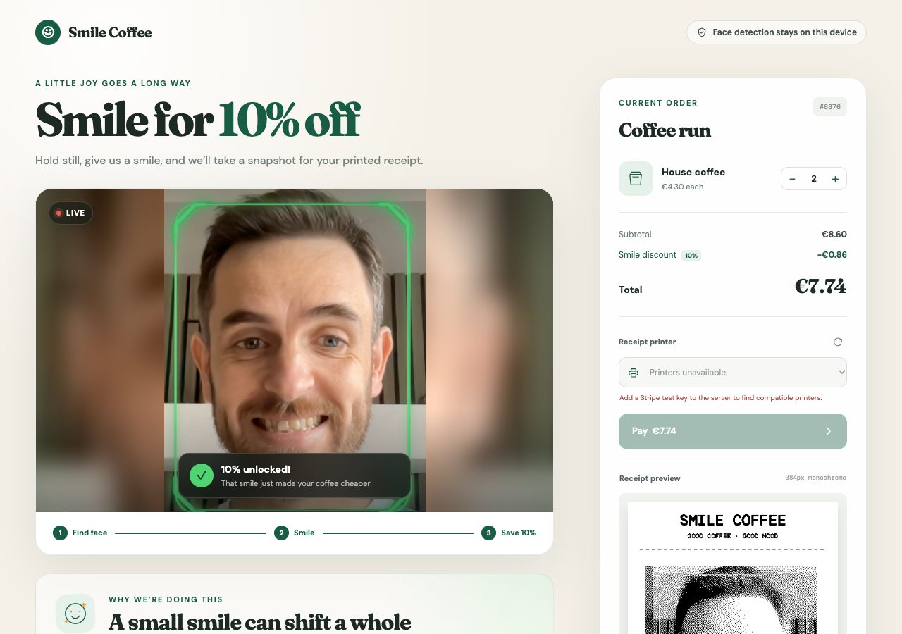
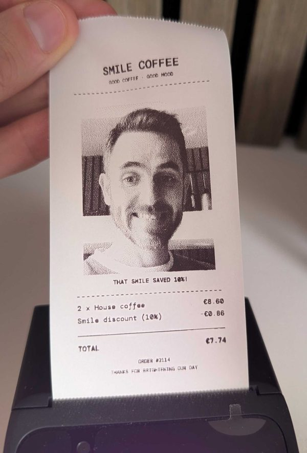

# Smile Printer

Smile at the till for 10% off your coffee, pay on a Stripe Terminal reader, and get a receipt with your photo printed on it.

Face and smile detection run entirely in the browser. Live video never leaves the device.



## Read the write-up

This is the companion code for a two-part series on [conroyp.com](https://www.conroyp.com):

1. **[Smile for 10% Off: Private Face Detection in the Browser](https://www.conroyp.com/articles/private-face-detection-browser-smile-discount)** - the camera, native `FaceDetector` vs MediaPipe, the smile state machine, moving the model into a Web Worker, and where the privacy boundary sits.
2. **[From Smile to Receipt: Stripe Terminal Payments and Printing](https://www.conroyp.com/articles/stripe-terminal-v660p-payments-receipt-printing)** - server-driven payments on a Verifone V660p, idempotent retries, and dithering a photo for a one-bit thermal printer.

## Quick start

You'll need Node.js 20.11 or newer, and a browser with a camera.

```bash
npm install
cp .env.example .env
npm run dev
```

Open [http://localhost:3000](http://localhost:3000), allow camera access, hold still, and smile.

**No Stripe key or card reader needed to try the smile detection.** Without them, the discount, photo capture and receipt preview all work - the Pay button just stays disabled until the server can find a printer.

There's no build step. The frontend is plain HTML and JavaScript, styled with [Tailwind's browser build](https://tailwindcss.com/docs/installation/play-cdn), and the server serves MediaPipe straight from `node_modules`.

## Taking payments and printing

To go all the way to a printed receipt, you'll also need:

- A Stripe account, with a **test-mode** secret key in `.env`:

  ```dotenv
  STRIPE_SECRET_KEY=sk_test_...
  ```

- A **Verifone V660p**, registered to the same Stripe account and showing as online. It's a card reader with a built-in thermal printer. Availability varies by country, so check Stripe's [V660p setup guide](https://docs.stripe.com/terminal/payments/setup-reader/v660p) first.

Restart the server, pick the reader from the **Receipt printer** dropdown, and press **Pay**. Tap a [Stripe physical test card](https://docs.stripe.com/terminal/references/testing#physical-test-cards) on the reader, and the receipt prints once the payment succeeds.

<p align="center"></p>

## How it works

```text
Browser                           Node server                     Stripe / V660p
   │                                   │                                │
   │  camera → worker → smile score    │                                │
   │  capture + render receipt locally │                                │
   │                                   │                                │
   │── POST /api/payments ────────────>│── create PaymentIntent ───────>│
   │                                   │── process on reader ──────────>│
   │                                   │── poll reader + intent ───────>│
   │<── confirmed payment ─────────────│<───────────────────────────────│
   │                                   │                                │
   │── POST /api/receipts/print ──────>│── validate + optimise image    │
   │                                   │── submit print_content ───────>│
   │                                   │── poll print action ──────────>│
   │<── confirmed print ───────────────│<───────────────────────────────│
```

- **The browser** runs [MediaPipe Face Landmarker](https://ai.google.dev/edge/mediapipe/solutions/vision/face_landmarker/web_js) in a Web Worker, sending at most one camera frame at a time. Once a face has held still for 1.5 seconds and smiled for one, it captures a single photo, and draws a 384px black and white receipt with a dithered copy of it.
- **The server** keeps the Stripe secret key out of the browser, works out the price itself, and uses Stripe's [server-driven Terminal integration](https://docs.stripe.com/terminal/payments/collect-card-payment?terminal-sdk-platform=server-driven) to take the payment. Only once the payment has succeeded does it accept the receipt image, which it checks with [Sharp](https://sharp.pixelplumbing.com/) before sending it to the reader's printer.
- **Retries are safe.** Payments use an idempotency key, so "Check payment" after a timeout never charges twice, and "Retry receipt" after a printer jam only reprints.

| File | What's in it |
|---|---|
| [`frontend/app.js`](frontend/app.js) | UI, camera, and the face/smile state machine |
| [`frontend/face-detector.js`](frontend/face-detector.js) | Talks to the worker, one frame at a time, and cleans up on page exit |
| [`frontend/face-landmarker.worker.js`](frontend/face-landmarker.worker.js) | MediaPipe, returning just a face box and smile score |
| [`frontend/receipt.js`](frontend/receipt.js), [`receipt-image.js`](frontend/receipt-image.js) | Receipt layout, and photo prep + Atkinson dithering |
| [`server/app.js`](server/app.js) | Express routes and request validation |
| [`server/terminal-service.js`](server/terminal-service.js) | Stripe payments, reader polling and printing |

## Privacy

| Data | Where it's processed | Leaves the browser? |
|---|---|---|
| Live video frames | Web Worker | No |
| Face position and smile score | Web Worker | No |
| Captured photo | Browser memory | Only after payment, as part of the receipt |
| Receipt image | Our server, then Stripe | Yes, to be printed |

The app never writes photos or receipts to disk. The page also loads Tailwind from jsDelivr, fonts from Google Fonts, and the face model from Google's model storage, but no camera frames are sent with any of those requests.

## Configuration

All optional, apart from `STRIPE_SECRET_KEY` for payments. See [`.env.example`](.env.example).

| Variable | Default | Purpose |
|---|---|---|
| `STRIPE_SECRET_KEY` | - | Server-side Stripe secret key |
| `STRIPE_CONNECTED_ACCOUNT_ID` | - | The connected account that owns the reader, if you're using Connect |
| `STRIPE_CURRENCY` | `eur` | Payment currency |
| `COFFEE_PRICE` | `430` | Price per coffee, in the currency's smallest unit (cents) |
| `PORT` | `3000` | HTTP port |
| `PAYMENT_POLL_ATTEMPTS` / `PAYMENT_POLL_INTERVAL_MS` | `90` / `1000` | How long to wait for a payment |
| `PRINT_POLL_ATTEMPTS` / `PRINT_POLL_INTERVAL_MS` | `15` / `1000` | How long to wait for a print |

Why €4.30? Stripe's test card uses the last two digits of the amount to simulate outcomes like declines. €4.30 keeps the totals for one to four coffees, with or without the discount, clear of those special endings. If you change the price and a test payment is declined, check the [test amounts](https://docs.stripe.com/terminal/references/testing#physical-test-cards) before debugging anything else.

## Troubleshooting

**The camera doesn't start.** Use `localhost` or HTTPS, allow camera access in the browser's site settings, and close any other app that's using the camera.

**No printers in the dropdown.** Check the V660p is powered on, online in the Stripe Dashboard, and registered to the same account and mode (test or live) as your key. If you're using Connect, set `STRIPE_CONNECTED_ACCOUNT_ID`.

**The payment worked, but nothing printed.** Fix the paper, cover or connection, then press **Retry receipt**. It only reprints - the customer isn't charged again.

## Tests

```bash
npm test
```

Node's built-in test runner, with a mocked Stripe client. No key, reader or network needed.

## Not production-ready

This is a deliberately small demo. A real till would also need operator authentication, HTTPS, compiled CSS instead of Tailwind's browser build ([here's how](https://www.conroyp.com/articles/tailwind-cdn-to-production-optimised-css-bundle)), webhooks and durable order state rather than holding a request open while polling, refund and cancellation handling, and a proper look at consent and privacy for receipt photos. The discount flag is also taken on trust from the browser - checking it server-side would mean sending the customer's face to the server, which this demo is deliberately avoiding.

## More like this

Smile Coffee grew out of my talk [Delete Your Dependencies: What the Browser Can Do Now](https://www.conroyp.com/speaking/delete-your-dependencies-what-the-browser-can-do-now). Its demo app, [conroyp/delete-your-dependencies](https://github.com/conroyp/delete-your-dependencies), has a browser-only version of the smile check, alongside QR scanning, Web Bluetooth printing, on-device AI and more.

## Licence

[MIT](LICENSE) © 2026 Paul Conroy
